# Rapport Technique — De la facture scannée à l'Agent IA

**Auteurs :** Théo Constantin & Quentin Jacquot  
**Projet Data & IA (DAMS5)** — Chaîne complète d'ingestion documentaire, d'OCR, de structuration Médaillon, d'entrepôt analytique DuckDB, d'exposition MCP et d'interrogation par Agent IA multi-LLM.

---

## Résumé exécutif

Ce projet met en œuvre une chaîne de traitement reproductible transformant **100 factures PDF hétérogènes** (50 PDF natifs et 50 PDF scannés sous forme d'images) stockées dans un bucket S3 (`s3://factures`) en un entrepôt analytique interrogeable en langage naturel par un assistant IA via le protocole **MCP (Model Context Protocol)**.

Les résultats expérimentaux clés obtenus sur le jeu de données complet sont les suivants :
- **Triage amont 100 % exact** : 50 PDF natifs extraits en moyenne en **10,61 ms/document** et 50 PDF scannés OCRisés via **LightOnOCR-3-1B** en **8,89 s/document**, divisant par deux le nombre d'appels au modèle de vision.
- **Qualité des données Silver** : **99 factures valides** (`270` lignes d'articles, total cumulé `872 687,53 € TTC`) et **1 facture rejetée en quarantaine** (`facture_V-2025-0001_scan.pdf`, code `INCOHERENCE_TTC` : `148,26 € HT + 29,65 € TVA = 177,91 €` vs `99 999,99 €` déclarés).
- **Benchmark OCR stratifié (15 factures, 255 champs)** : **100,00 % d'exactitude** à la résolution recommandée (`1540 px`, `9,03 s/page`, `1090,96 Ko`), contre **42,75 %** à basse résolution (`512 px`, `5,53 s/page`, `99,80 Ko`), avec un effondrement complet (`0,00 %`) sur les identifiants à haute entropie (`SIRET`, `TVA intracom.`, `IBAN`).
- **Serveur MCP & Agent Multi-LLM** : 6 outils exposés avec **13/13 tests automatisés validés** (anti-injection SQL, verrouillage `read_only=True`, transparence `executed_sql`). Sur la question de référence (*« Quel est le montant TTC des factures en retard en 2025 ? »*), les deux modèles comparés (`gemma-4-12b` et `granite-4-2-8b`) restituent la valeur exacte calculée en SQL : **12 factures pour 106 886,43 € TTC**.

---

## 1. Architecture globale et justification des choix techniques

### 1.1 Schéma d'architecture de bout en bout

```mermaid
flowchart LR
    S3["Bucket S3 Hyperfluid<br/>(s3://factures, 100 PDF)"] -->|boto3 incrémental| Raw["Landing Zone<br/>(data/raw_pdfs/)"]
    Raw -->|"PyMuPDF >= 50 car."| Native["50 PDF Natifs<br/>(pymupdf_native, ~10.6 ms)"]
    Raw -->|"PyMuPDF < 50 car."| OCR["50 PDF Scannés<br/>LightOnOCR-3-1B (1540 px, ~8.9 s)"]
    Native --> Bronze[("Couche Bronze<br/>data/bronze/documents.parquet<br/>Append-Only + SHA-256")]
    OCR -->|"OCRProvider ABC"| Bronze
    OCR -.->|"Échec API"| ErrLog["ingestion_errors.jsonl<br/>(Reprise au run suivant)"]
    Bronze -->|"Parseur Natif + HTML/MD<br/>Decimal(12,2) + Contrôles"| Silver[("Couche Silver<br/>factures.parquet (99)<br/>lignes_facture.parquet (270)")]
    Bronze -->|"Anomalies bloquantes"| Quar[("Quarantaine<br/>quarantaine.parquet (1)")]
    Bronze --> Views["Entrepôt DuckDB<br/>(data/warehouse.duckdb)<br/>Vues SQL relatives, 0 table physique"]
    Silver --> Views
    Quar --> Views
    Views -->|"read_only=True"| Gold["Vues Gold (Bonus)<br/>kpi_mensuels / kpi_fournisseurs"]
    Views -->|"read_only=True (JDBC)"| DBeaver["DBeaver (Accès concurrent)"]
    Views -->|"read_only=True"| MCP["Serveur MCP (FastMCP stdio)<br/>6 outils + executed_sql"]
    MCP <-->|"JSON-RPC stdio"| Agent["Agent IA Multi-LLM<br/>(gemma-4-12b / granite-4-2-8b / ...)"]
```



```text
PDF (S3) ─► PyMuPDF ─┬─► Texte natif (50) ──┐
                     └─► LightOnOCR-3 (50) ─┴─► Bronze (Parquet) ─► Silver + Quarantaine (Parquet)
                                                                              │
                 Agent IA Multi-LLM ◄─ Serveur MCP (FastMCP) ◄─ Entrepôt DuckDB (Vues SQL)
```

### 1.2 Justifications des briques techniques

#### Gestionnaire de projet et langage (`Python 3.12` + `uv`)
Le projet repose sur Python 3.12 et le gestionnaire **`uv`** (`pyproject.toml` + `uv.lock`). Ce choix garantit une résolution déterministe et rapide des dépendances (`boto3`, `pymupdf`, `httpx`, `pyarrow`, `duckdb`, `mcp[cli]<2`, `pydantic`, `rich`) ainsi qu'un lancement reproductible sur toute machine via `uv run python -m ...`.

#### Triage amont par inspection interne (`PyMuPDF`)
Dans `src/step1_ingest.py`, chaque PDF est classé selon son contenu interne réel : extraction du texte natif par page avec `pymupdf`, suppression des caractères blancs (`"".join(text.split())`) et comparaison au seuil `TEXT_CHAR_THRESHOLD = 50`.
- **Résultat observé** : sur les 100 factures du bucket, l'heuristique identifie exactement **50 PDF `"texte"`** (~2,9 Ko, ≥ 700 caractères, 0 image) et **50 PDF `"image"`** (~210 à 315 Ko, 0 caractère natif, 1 image matricielle), en concordance à 100 % avec les suffixes `_texte.pdf` et `_scan.pdf` sans jamais s'appuyer sur le nom du fichier.
- **Gain** : éviter tout appel OCR inutile sur les PDF natifs réduit de moitié la latence et les coûts GPU, tout en conservant une extraction textuelle sans erreur typographique.

#### Découplage du fournisseur d'OCR (`OCRProvider` ABC + `LightOnOCR-3-1B`)
Conformément aux recommandations de la *model card* `lightonai/LightOnOCR-3-1B` (encodeur visuel Pixtral + décodeur Qwen servi par vLLM), `LightOnOCRProvider` (`src/ocr.py`) redimensionne chaque page en PNG de sorte que le plus grand côté atteigne **`1540` pixels** (~`1089 × 1540` px pour une page A4, ~1,1 Mo), encode l'image en Base64 (`data:image/png;base64,...`) et interroge l'endpoint OpenAI Chat Completions sans prompt texte (`temperature=0.0`, `max_tokens=4096`).

Pour éviter tout couplage fort avec l'API Hyperfluid, `src/ocr.py` implémente le patron **Strategy / Adapter** via la classe abstraite `OCRProvider` (`extract_page` / `extract_document`) et la dataclass `OCRPageResult`. Remplacer `LightOnOCR-3` par `lightonocr-2-1b`, Mistral OCR ou un moteur local (Tesseract, PaddleOCR) ne requiert que l'ajout d'une sous-classe de `OCRProvider`, sans modifier une seule ligne du pipeline Bronze.

#### Architecture Médaillon en Apache Parquet (Bronze / Silver / Gold)
Les données persistées sont stockées localement au format colonnaire compressé **Apache Parquet** (`pyarrow`, compression Snappy), qui préserve nativement le typage fort (`DECIMAL(12, 2)`, `DATE`, `TIMESTAMP WITH TIME ZONE`).

1. **Couche Bronze (`data/bronze/documents.parquet`) — Immuabilité et idempotence par SHA-256**
   - **Clé d'idempotence** : `doc_id = file_sha256` (empreinte SHA-256 du binaire PDF). Le nom du fichier ne suffit pas : un fichier corrigé réuploadé sous le même nom doit être réingéré, tandis qu'un fichier renommé au contenu identique ne doit pas déclencher un second appel OCR.
   - **Traçabilité (*Data Lineage*)** : chaque ligne enregistre `doc_id`, `file_sha256`, `filename`, `source_uri`, `file_size_bytes`, `page_count`, `pdf_type`, `extraction_method`, `ocr_model`, `ocr_longest_edge`, `raw_text`, `char_count`, `processing_time_ms` et `ingested_at` (UTC).
   - **Tolérance aux pannes et checkpointing** : l'écriture s'effectue de manière atomique (`documents.parquet.tmp` → `os.replace`) après chaque document extrait. En cas d'indisponibilité OCR (testée via `--simulate-ocr-error`), l'erreur est tracée en JSONL dans `data/bronze/ingestion_errors.jsonl` sans interrompre le pipeline, et le document absent de `documents.parquet` est automatiquement repris à l'exécution suivante.
   - **Pourquoi ne jamais modifier ni supprimer Bronze ?** Bronze constitue la source de vérité historique immuable (*append-only*). L'ingestion complète des 100 factures a nécessité **444,52 s** d'appels OCR ; grâce à Bronze, toute évolution ou correction du parseur Silver se rejoue intégralement sur les 100 documents en **moins d'une seconde** sans aucun appel API supplémentaire.

2. **Couche Silver (`data/silver/`) — Typage strict, contrôles qualité et quarantaine**
   - **Typage monétaire `DECIMAL(12, 2)` vs `float` IEEE 754** : les nombres flottants binaires ne représentent pas exactement les fractions décimales de base 10 (`0.1 + 0.2 = 0.30000000000000004` en IEEE 754), ce qui fausserait les égalités comptables ($\text{HT} + \text{TVA} = \text{TTC}$) et cumulerait des écarts sur les agrégations. Tous les montants utilisent `decimal.Decimal` quantisé au centime (`ROUND_HALF_UP`) et `pa.decimal128(12, 2)`. Les dates utilisent `datetime.date` (`pa.date32()`).
   - **Distinction *Rejetée* vs *Signalée*** :
     - **`REJETEE` → `quarantaine.parquet`** (exclue de `factures.parquet` et `lignes_facture.parquet`) : anomalie bloquante sur l'intégrité financière, la présence des champs obligatoires ou l'unicité (`ERREUR_PARSING`, `CHAMPS_OBLIGATOIRES_MANQUANTS`, `DOUBLON_FACTURE`, `MONTANT_NEGATIF_OU_NUL`, `INCOHERENCE_LIGNE_HT`, `INCOHERENCE_SOMME_LIGNES`, `INCOHERENCE_TVA`, `INCOHERENCE_TTC`). En cas de doublon natif/scan, le pipeline privilégie la version native.
     - **`SIGNALEE` → `factures.parquet` avec `quality_status = 'SIGNALEE'`** : montants exacts, mais anomalie non bloquante (`DATE_ECHEANCE_INCOHERENTE`, `SIRET_INVALIDE`, `IBAN_MANQUANT_OU_INVALIDE`, `STATUT_OU_CATEGORIE_INCONNU`).
   - **Pourquoi ne jamais corriger automatiquement un montant incohérent ?** Une facture possède une valeur comptable et fiscale légale. Sur `facture_V-2025-0001_scan.pdf`, les lignes et totaux indiquent `148,26 € HT` et `29,65 € TVA` (soit `177,91 € TTC`), mais le document affiche **`99 999,99 € TTC`** (écart de `99 822,08 €`). Corriger automatiquement le TTC reviendrait à falsifier une pièce ou masquer une anomalie fournisseur ; la mise en quarantaine préserve la donnée brute et expose explicitement l'écart.
   - **Bilan sur les 100 factures** : **99 factures `VALIDE`** (`270` lignes d'articles, `727 239,61 € HT`, `145 447,92 € TVA`, `872 687,53 € TTC`), **0 `SIGNALEE`** et **1 `REJETEE`** (`V-2025-0001`).

#### Séparation Stockage / Calcul dans DuckDB (`data/warehouse.duckdb`)
Dans `src/step6_warehouse.py`, DuckDB joue exclusivement le rôle de moteur de calcul SQL : **`data/warehouse.duckdb` ne contient aucune table physique (`0 BASE TABLE`)**, mais uniquement **3 schémas (`bronze`, `silver`, `gold`) et 11 vues SQL** lisant dynamiquement les fichiers Parquet via des chemins relatifs (`read_parquet('data/...')`).
- **Portabilité** : l'usage de chemins relatifs associés à `SET file_search_path = '<BASE_DIR>'` à l'ouverture de la connexion garantit que l'entrepôt fonctionne sans modification chez un collègue ou dans un conteneur.
- **Accès concurrents** : `init_warehouse()` referme immédiatement la connexion d'écriture après création des vues (< 150 ms). Ensuite, Python, le serveur MCP et DBeaver (`duckdb.read_only = true`) ouvrent tous l'entrepôt en mode `read_only=True`, validé par un test multi-processus simultané (`853 ms`, 0 verrou bloquant).
- **Bonus Couche Gold** : 3 vues analytiques (`gold.kpi_mensuels`, `gold.kpi_fournisseurs`, `gold.factures_en_retard`) préparent les indicateurs métier récurrents.

---

## 2. Résultats de l'évaluation OCR (Étape 5) et analyse critique

### 2.1 Méthodologie et constitution de la vérité terrain

Pour mesurer objectivement la qualité de `LightOnOCR-3-1B` sans saisie manuelle fastidieuse, une vérité terrain stratifiée (`data/ground_truth.json`, versionnée dans Git) a été constituée sur **15 factures scannées (`_scan.pdf`)** — soit **30 % de la population scannée** — couvrant l'ensemble des **8 fournisseurs** (`A`, `BS`, `C`, `GPE`, `LG`, `MS`, `P`, `V`), de 1 à 5 lignes d'articles, ainsi que la facture en quarantaine `facture_V-2025-0001_scan.pdf`.

L'exactitude à 100 % des **17 champs évalués** par facture (`255` points de contrôle par réglage) a été établie par triple croisement :
1. **Référentiel des 8 fournisseurs et clients** extrait des 50 factures natives (`supplier_name`, `supplier_siret`, `supplier_tva_intracom`, `iban`, `client_siret`).
2. **Contraintes algébriques exactes** ($\text{Qté} \times \text{PU} = \text{Total ligne}$, $\sum \text{lignes} = \text{Total HT}$, $\text{HT} \times 20\% = \text{TVA}$, $\text{HT} + \text{TVA} = \text{TTC}$).
3. **Inspection visuelle directe** des 15 images PDF rendues.

### 2.2 Tableau comparatif des résultats (`1540 px` vs `512 px`)

Le programme `src/step5_eval_ocr.py` réutilise Bronze pour `1540 px` (recommandation *model card*) et interroge LightOnOCR-3 à `512 px` (basse résolution), en passant les deux sorties exactement dans le même parseur Silver :

| Métrique globale (15 factures scannées) | `1540 px` (recommandé) | `512 px` (basse résolution) | Évolution (`512` vs `1540`) |
|---|---:|---:|---:|
| Poids PNG moyen envoyé | `1 090,96 Ko` | `99,80 Ko` | `-90,85 %` |
| Temps OCR moyen par page | `9 029 ms` (`9,03 s`) | `5 528 ms` (`5,53 s`) | `-38,77 %` |
| **Exactitude globale (255 champs)** | **`100,00 %` (`255/255`)** | **`42,75 %` (`109/255`)** | **`-57,25 pts`** |
| **Factures 100 % parfaites (17/17 champs)** | **`15 / 15` (`100,0 %`)** | **`0 / 15` (`0,0 %`)** | **`-100,0 pts`** |

#### Précision détaillée champ par champ

| Champ évalué | `1540 px` Exact | `512 px` Exact | `512 px` Similarité | `512 px` CER |
|---|---:|---:|---:|---:|
| `supplier_siret` | `100,00 %` | **`0,00 %` (`0/15`)** | `51,56 %` | `48,57 %` |
| `supplier_tva_intracom` | `100,00 %` | **`0,00 %` (`0/15`)** | `23,08 %` | `76,92 %` |
| `iban` | `100,00 %` | **`0,00 %` (`0/15`)** | `17,04 %` | `82,96 %` |
| `client_name` | `100,00 %` | **`13,33 %` (`2/15`)** | `52,49 %` | `47,51 %` |
| `invoice_number` | `100,00 %` | **`20,00 %` (`3/15`)** | `87,10 %` | `12,90 %` |
| `client_siret` | `100,00 %` | **`20,00 %` (`3/15`)** | `74,76 %` | `25,24 %` |
| `issue_date` | `100,00 %` | `40,00 %` (`6/15`) | `68,67 %` | `31,33 %` |
| `lines_total_ht_sum` | `100,00 %` | `40,00 %` (`6/15`) | `82,90 %` | `17,10 %` |
| `due_date` | `100,00 %` | `53,33 %` (`8/15`) | `82,00 %` | `18,00 %` |
| `supplier_name` | `100,00 %` | `53,33 %` (`8/15`) | `90,86 %` | `9,14 %` |
| `status` | `100,00 %` | `60,00 %` (`9/15`) | `88,37 %` | `12,30 %` |
| `total_ht` | `100,00 %` | `60,00 %` (`9/15`) | `88,77 %` | `11,23 %` |
| `category` | `100,00 %` | `66,67 %` (`10/15`) | `86,81 %` | `13,23 %` |
| `line_count` | `100,00 %` | `66,67 %` (`10/15`) | `66,67 %` | `33,33 %` |
| `payment_method` | `100,00 %` | `73,33 %` (`11/15`) | `86,19 %` | `13,81 %` |
| `total_tva` | `100,00 %` | `80,00 %` (`12/15`) | `96,44 %` | `3,56 %` |
| `total_ttc` | `100,00 %` | `80,00 %` (`12/15`) | `97,38 %` | `2,62 %` |

### 2.3 Analyse des fragilités observées

Les résultats mettent en lumière deux phénomènes complémentaires propres aux modèles vision-langage (VLM) :
1. **Entropie informationnelle vs redondance linguistique** : à `512 px` (`~362 × 512 px`), les mots courants du dictionnaire français (`payment_method` 73,33 %, `category` 66,67 %) restent en partie corrigeables par le décodeur linguistique Qwen grâce au contexte sémantique, et `total_ttc` (80,00 %) bénéficie d'une police en **gras** plus lisible. À l'inverse, les **chaînes numériques et alphanumériques aléatoires** sans redondance (`IBAN` à 27 caractères, `SIRET` à 14 chiffres, `TVA intracom.`) n'offrent aucun prieur lexical au modèle : le moindre crénelage provoque des confusions systématiques (`A-2025-0003` → `A-2035-0003`, `29/04/2025` → `29/04/2020`, `25 113,14 €` → `35 113,14 €`, `633,90 €` → `633,50 €`) et dégrade jusqu'aux étiquettes (`SIRET` → `SRST`, `IBAN` → `BAN`, `TVA intracom.` → `TVA intrazon.`).
2. **Dégradation structurelle** : à `512 px`, le modèle fusionne fréquemment les lignes de totaux dans le tableau d'articles (`<td colspan="4">Total HT</td>`) et altère l'en-tête client (`Facturé à :` → `Facture 4 :`), expliquant la chute de `client_name` (`13,33 %`) et `line_count` (`66,67 %`).

**Conclusion opérationnelle** : le gain de latence de `3,5 s` à `512 px` est inutilisable en comptabilité (0 % de factures parfaites). La résolution `1540 px` recommandée par la *model card* constitue le point de fonctionnement optimal (100 % d'exactitude sur les 255 champs).

---

## 3. Serveur MCP et Agent IA Multi-LLM (Étapes 7 & 8)

### 3.1 Conception du serveur MCP (`FastMCP`) : outils, sécurité et transparence

Le serveur `src/mcp_server.py` (transport `stdio`) expose **6 outils** typés par `pydantic.Field` :
1. `list_invoices` : liste paginée (`limit <= 100`) avec filtres combinables (`supplier_name`, `client_name`, `status`, `category`, `year`, `date_from`, `date_to`, `min_ttc`, `max_ttc`).
2. `get_invoices_summary` : agrégation (`COUNT`, `SUM(total_ht/tva/ttc)`, `AVG`, `MIN`, `MAX`) avec les mêmes filtres et un paramètre `group_by` validé contre une liste blanche stricte.
3. `get_invoice_details` : recherche d'une facture dans `silver.factures` + `silver.lignes_facture` + traçabilité `bronze.documents`, avec bascule automatique sur `silver.quarantaine` si la facture a été rejetée.
4. `get_schema` : découverte dynamique des schémas, colonnes, types SQL et valeurs distinctes de `status`, `category` et `supplier_name`.
5. `execute_readonly_sql` : SQL libre plafonné à 200 lignes pour les analyses complexes non couvertes par les outils structurés.
6. `get_gold_kpis` : accès direct aux rapports Gold (`fournisseurs`, `mensuel`, `retards`, `quarantaine`).

#### Réponses aux enjeux de sécurité et d'ergonomie LLM
- **Guidage du LLM par les descriptions** : les docstrings distinguent explicitement les cas d'usage (`get_invoices_summary` pour « Combien / Quel est le total » vs `list_invoices` pour énumérer) et documentent les valeurs exactes des énumérations (`status` $\in$ `{'Payée', 'En retard', 'En attente'}`).
- **Défense en profondeur contre les injections SQL** : aucun paramètre fourni par le LLM n'est interpolé dans une requête (`ILIKE '%' || ? || '%'` avec paramètres liés `?` de DuckDB). Sur `execute_readonly_sql`, une validation syntaxique mono-instruction n'autorisant que `SELECT`/`WITH`/`DESCRIBE`/`SHOW`/`EXPLAIN` (bloquant `DROP`, `DELETE`, `INSERT`, `UPDATE`, `ALTER`, `CREATE`, `COPY`, `ATTACH`, `;`) s'ajoute au verrou matériel `read_only=True` du moteur DuckDB.
- **Transparence et auto-correction (*Self-Correction*)** : chaque réponse JSON inclut `status`, `tool`, `executed_sql`, `sql_params` et `data`, ou en cas d'erreur `error_message` + un `hint` actionnable indiquant les vues exactes et invitant à appeler `get_schema`.
- **Validation automatisée (`src/step7_test_mcp.py`)** : **13/13 tests PASS** via `MCPClient` (incluant la neutralisation d'une injection `"' OR 1=1 --"`, la détection de quarantaine `V-2025-0001`, le `hint` sur colonne invalide `montant_ttc`, et le rejet strict de `DROP`, `DELETE`, `CREATE`).

### 3.2 Agent IA Multi-LLM et comparaison expérimentale

L'agent (`src/agent/` + `src/step8_agent.py`) reprend le découplage `ToolCall` / `ToolResult` / `LLMResponse` / `ToolManager` / `Chat` et bloque les hallucinations par 4 mécanismes :
1. `temperature = 0.0` (décodage déterministe).
2. `SYSTEM_PROMPT` strict en français interdisant d'inventer des chiffres ou de sommer de tête.
3. Délégation systématique de tout calcul arithmétique à DuckDB via MCP.
4. Affichage transparent étape par étape (`[1]` Outil & arguments JSON, `[2]` SQL `executed_sql`, `[3]` extrait JSON MCP, `[4]` réponse finale).

#### Comparaison expérimentale de deux LLMs sans modifier le code (`--compare-models`)
Scénario multi-tours : **Q1** = *« Quel est le montant TTC des factures en retard en 2025 ? »*, **Q2** = *« Et peux-tu me donner le détail de la facture V-2025-0001 ? »*.

| Modèle Hyperfluid | Paramètres | Temps total (Q1 + Q2) | Outils choisis (Q1 → Q2) | Vérif. SQL Q1 | Observation qualitative Q2 (`V-2025-0001`) |
|---|---:|---:|---|:---:|---|
| **`gemma-4-12b`** | 12B | `17,97 s` (`6,73 s` + `11,29 s`) | `get_invoices_summary` → `get_invoice_details` | **EXACT** (`12` factures, `106 886,43 € TTC`) | Exact sur tous les montants (`148,26 €`, `29,65 €`, `177,91 €`, `99 999,99 €`) et sur l'écart (`99 822,08 €`). |
| **`granite-4-2-8b`** | 8B | `19,04 s` (`6,02 s` + `13,60 s`) | `get_invoices_summary` → `get_invoice_details` | **EXACT** (`106 886,43 € TTC`) | Exact sur les valeurs lues (`148,26 €`, `29,65 €`, `177,91 €`, `99 999,99 €`), **mais erreur de retenue en prose libre sur la soustraction de l'écart** (`98 822,08 €` au lieu de `99 822,08 €`). |

**Enseignement clé** : grâce à la qualité des descriptions MCP, le modèle plus léger (`granite-4-2-8b`) sélectionne les mêmes outils optimaux que `gemma-4-12b`. En revanche, dès qu'un petit modèle tente de recalculer une soustraction dans ses poids neuronaux au lieu de recopier ou de déléguer le calcul au SQL, une erreur d'une retenue apparaît — confirmant le principe directeur : **tout calcul financier doit être exécuté côté DuckDB**.

---

## 4. Proposition d'industrialisation argumentée (Étape 9)

Pour passer d'un prototype mono-machine (100 factures) à une plateforme de production traitant **des milliers de factures par mois pour plusieurs utilisateurs simultanés**, nous structurons l'industrialisation selon **4 priorités ordonnées** :

### Priorité 1 — Stockage partagé S3 et format transactionnel Lakehouse (Iceberg)
Aujourd'hui, les couches Bronze/Silver reposent sur des fichiers Parquet locaux réécrits atomiquement. À l'échelle multi-utilisateurs et multi-workers :
- Déplacer Bronze, Silver et Gold vers des buckets S3 dédiés (`s3://factures-bronze`, `s3://factures-silver`, `s3://factures-gold`).
- Adopter un format de table ouvert **Apache Iceberg** (ou DuckLake) au-dessus de Parquet : il apporte les transactions **ACID**, l'écriture concurrente sans corruption, le *time travel* et l'évolution de schéma sans réécrire les partitions historiques. DuckDB lit nativement les tables Iceberg via son extension dédiée.

### Priorité 2 — Montée en charge de l'OCR et orchestration événementielle
Avec un appel synchrone séquentiel (~8,9 s/page), `5 000` factures mensuelles prendraient plus de `12 heures` sur un seul fil d'exécution.
- **Parallélisation asynchrone & Continuous Batching vLLM** : remplacer les appels séquentiels de `LightOnOCRProvider` par un worker `asyncio` + `httpx.AsyncClient` avec une file bornée (`asyncio.Semaphore(16)`), exploitant le *continuous batching* de vLLM sur GPU pour diviser le temps de traitement global par un facteur ~8 à 12 (`< 1 heure` pour 5 000 pages).
- **Orchestration événementielle** : déclencher l'ingestion Bronze → Silver via un orchestrateur (**Dagster** ou **Airflow**) sur événement S3 (`ObjectCreated` / file SQS-RabbitMQ), avec politique de *retry* exponentiel et routage vers une *Dead-Letter Queue* en cas d'échec persistant, complété par une alerte (Slack/email) dès qu'une facture tombe en quarantaine.

### Priorité 3 — Déploiement multi-utilisateurs du serveur MCP et de l'Agent (Kubernetes / CaaSThor)
Le transport `stdio` est adapté à un client local mono-utilisateur (CLI ou Claude Desktop). En production :
- Conteneuriser le serveur MCP (`python:3.12-slim` + `uv`) et le déployer sur **Hyperfluid CaaSThor / Kubernetes** en basculant `FastMCP` sur le transport réseau **Streamable HTTP / SSE**.
- Ajouter une passerelle d'authentification (**OAuth2 / JWT / API Key**) et un contrôle d'accès (**RBAC** : filtrage des vues par entité ou département).
- Déployer l'agent derrière une API FastAPI / interface web interne avec journalisation complète des conversations et des requêtes SQL exécutées.

### Priorité 4 — Sécurité, observabilité et gouvernance FinOps
- **Secrets** : injection via **Kubernetes Secrets** ou **HashiCorp Vault**, rotation périodique des clés API Sapience et politiques S3 au moindre privilège (`ReadOnly` sur le bucket d'entrée, `ReadWrite` restreint au pipeline sur Bronze/Silver).
- **Observabilité (OpenTelemetry / Prometheus)** : tracer trois indicateurs métier critiques — taux de mise en quarantaine (détection immédiate d'une dérive de gabarit fournisseur), latence P95 de l'OCR et taux d'erreurs SQL générées par l'agent.
- **FinOps** : maintenir le triage `PyMuPDF` amont (économie de ~50 % d'appels GPU sur les PDF natifs) et orienter les requêtes simples vers des modèles légers (`gemma-4-12b` ou `granite-4-2-8b`) tout en réservant les grands modèles aux analyses complexes.

---

## 5. Difficultés rencontrées, limites actuelles et pistes d'amélioration

### Difficultés rencontrées et résolues
1. **Hétérogénéité de mise en page entre PyMuPDF et LightOnOCR-3** : PyMuPDF linéarise les tableaux cellule par cellule sur des lignes séparées, tandis que LightOnOCR-3 émet du Markdown et des `<table>` HTML, tantôt avec 1 tableau + totaux Markdown, tantôt avec 2 tableaux HTML (et `<strong>` sur `Total TTC`), voire des lignes `colspan="4"` à `512 px`. L'inspection systématique des 100 `raw_text` Bronze a permis d'unifier l'extraction dans `src/step4_silver.py`.
2. **Compatibilité du SDK `mcp`** : la version `mcp 2.3.0` ayant renommé `FastMCP` en `MCPServer`, le verrouillage `mcp[cli]<2` (`1.30.0`) dans `pyproject.toml` a assuré la compatibilité directe avec l'architecture `FastMCP`.
3. **Filtrage des jetons internes des modèles vLLM** : `gemma-4-12b` émettait des balises `<|channel>thought...<channel|>` dans `content`, filtrées proprement dans `src/agent/llm.py`.

### Limites actuelles et pistes d'amélioration
- **Parseur déterministe par motifs/HTML** : très rapide et auditable sur les 8 gabarits fournisseurs connus (100 % de réussite sur les 100 factures), il nécessiterait une extension face à un fournisseur inconnu à mise en page radicalement différente. *Piste* : conserver le parseur déterministe en voie rapide et ajouter un **extracteur JSON structuré par LLM (Pydantic) uniquement en repli** si le parseur échoue, validé ensuite par les mêmes contrôles mathématiques stricts.
- **PDF multi-pages et revue de quarantaine** : les 100 factures actuelles sont mono-pages ; pour des factures multi-pages avec tableau scindé entre deux pages, il faudra agréger les tableaux sur l'ensemble des pages avant de calculer $\sum \text{lignes}$. Enfin, une interface légère *Human-in-the-Loop* permettrait aux comptables de statuer sur les factures en quarantaine (comme `V-2025-0001`) sans jamais altérer la couche Bronze.
